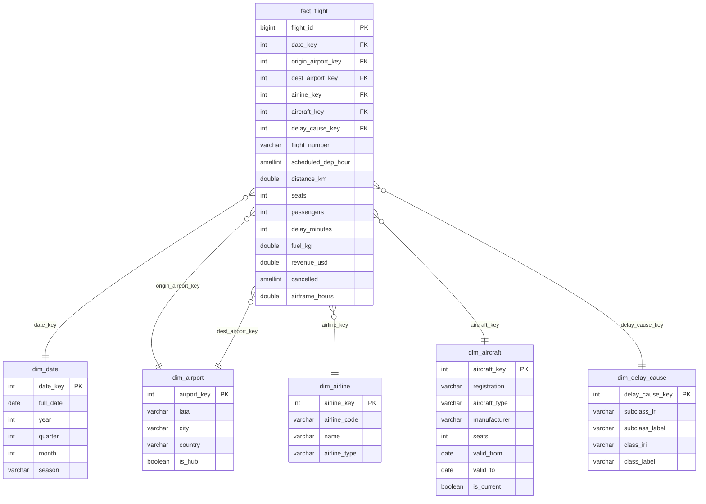

# Результат 1. Зіркова схема: управління авіаційними перевезеннями

## Бізнес-процес і зерно факту
**Бізнес-процес:** виконання регулярних пасажирських рейсів (flight operations).

**Зерно факту:** один рядок `fact_flight` = один рейс (flight leg) на конкретну дату між парою аеропортів, виконаний конкретним бортом (версією борту) авіакомпанії; скасований рейс теж є рядком.

## Бізнес-питання (≥ 5)
1. Яка частка рейсів виконана вчасно (затримка ≤ 14 хв) по авіакомпаніях і місяцях?
2. Які класи й підкласи причин затримок дають найбільше сумарних хвилин затримки? (drill-down клас → підклас)
3. Як пора року впливає на погодні затримки (туман, грози, сніг/лід, вітер)?
4. Які маршрути мають найбільшу середню затримку і чи пов'язано це з хабами?
5. Який коефіцієнт завантаження за типами літаків і типами авіакомпаній?
6. Скільки доходу втрачено через скасування рейсів у розрізі причин?
7. Як змінюється кількість пасажирів упродовж року (накопичення, ковзне середнє)?
8. Яка витрата пального на пасажиро-кілометр за типами літаків?

## Виміри (6 ролей, 5 таблиць)
| Вимір | Ключ | Атрибути | Ієрархія | SCD |
|---|---|---|---|---|
| `dim_date` | `date_key` (YYYYMMDD) | full_date, year, quarter, month, day, day_of_week, is_weekend, season | рік → квартал → місяць → день | не змінюється |
| `dim_airport` (role-playing: origin, destination) | `airport_key` | iata, name, city, country, lat/lon, is_hub | країна → місто → аеропорт | тип 1 |
| `dim_airline` | `airline_key` | airline_code, name, country, airline_type | тип → авіакомпанія | тип 1 |
| `dim_aircraft` | `aircraft_key` (сурогат версії) | registration, aircraft_type, manufacturer, seats, valid_from, valid_to, is_current | виробник → тип → борт | **тип 2** |
| **`dim_delay_cause` (таксономія, IRI)** | `delay_cause_key` | subclass_iri, subclass_label, class_iri, class_label | **клас → підклас** | тип 1 |

**Політика SCD.** `dim_aircraft` — тип 2: переобладнання салону змінює `seats`, тому створюється нова версія з інтервалом `[valid_from, valid_to)`; рейс прив'язується до версії, чинної на дату рейсу. Решта вимірів — тип 1 (перезапис), бо історія їхніх атрибутів не впливає на аналітику.

**Таксономія як вимір.** Лист таксономії причин затримок (підклас, напр. `Thunderstorm`) — це ключ у факті; клас (напр. `Weather`) денормалізовано в той самий вимір. Кожен вузол має IRI (`http://example.org/avia/delay#Thunderstorm`), тож drill-down клас → підклас виконується звичайним GROUP BY / ROLLUP. Рейси без затримки належать класу `NoDelay` (підклас `OnTime`).

## Міри
| Міра | Тип | Пояснення |
|---|---|---|
| `distance_km` | адитивна | сума налітаної відстані |
| `seats` | адитивна | запропоновані місця |
| `passengers` | адитивна | перевезені пасажири |
| `delay_minutes` | адитивна | сума хвилин затримки |
| `fuel_kg` | адитивна | витрачене пальне |
| `revenue_usd` | адитивна | дохід від рейсу |
| `cancelled` | адитивна | 0/1, сума = кількість скасувань |
| `airframe_hours` | **напівадитивна** | наліт борту (лічильник): сумується по бортах, але не в часі (беремо MAX/останнє значення) |
| load_factor, on_time_rate, avg_delay, revenue_per_pax | **неадитивні** (похідні) | відношення; рахуються як SUM/SUM, не усереднюються |

Вироджені виміри: `flight_number`, `scheduled_dep_hour`.

Примітка щодо ключів: `FOREIGN KEY` не оголошені (типова практика DW), цілісність перевіряється запитами «сиріт» у `etl/quality.py` (результат 2).

## Діаграма зірки

