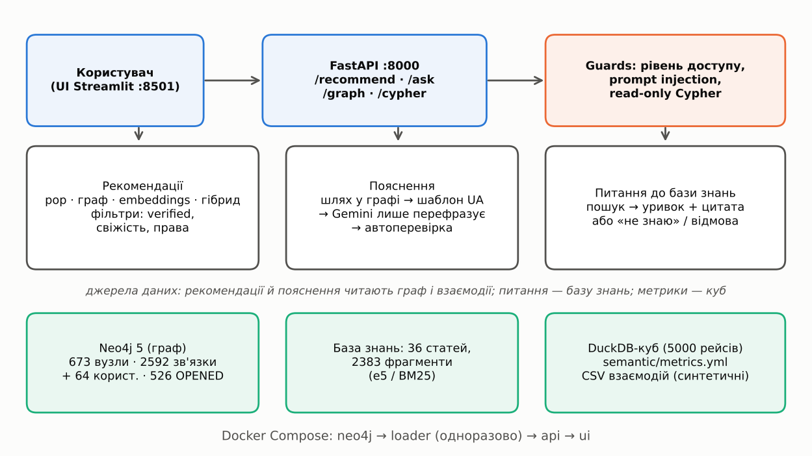
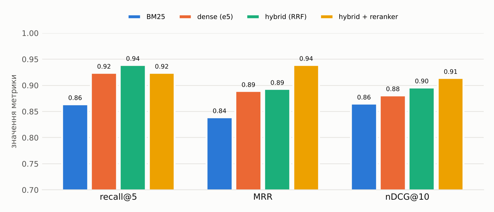
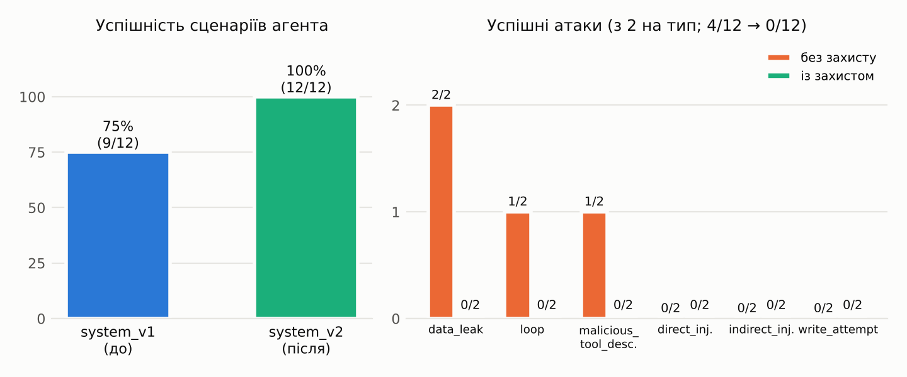
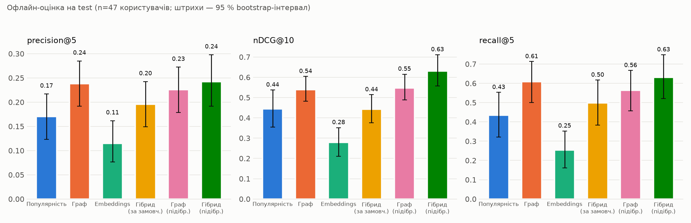
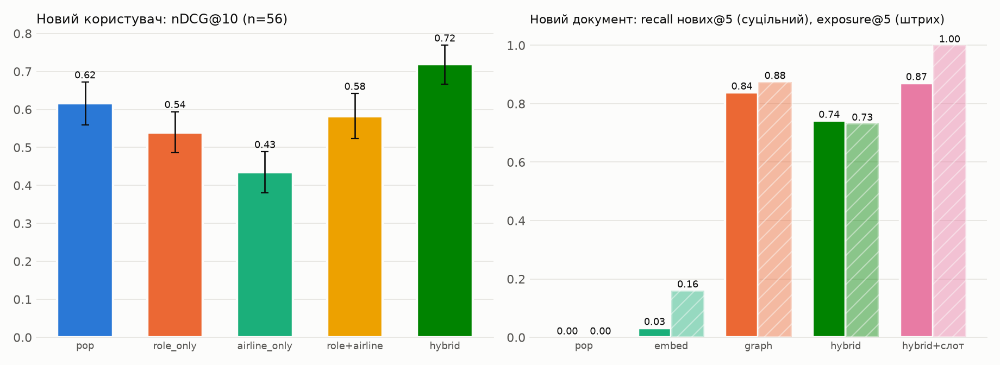

# Анотація

Aviation Knowledge Hub — навчальний прототип сховища знань для управління авіаційними перевезеннями: граф знань (Neo4j), пошук по базі знань, LLM-агент з обмеженими інструментами, а тепер ще й рекомендаційний модуль, який підказує фахівцям, які документи бази знань їм потрібні, і пояснює чому. Записка описує проблему, архітектуру, походження знань, виміряну якість за лабораторними роботами 9–16, ризики за Регламентом ЄС 2024/1689 (AI Act) і NIST AI RMF, економіку, обмеження та наступні кроки. Усі числа в тексті взяті з результатів, відтворюваних із репозиторію (`make test`, `make reco-eval`, `make cold-start`, `docker compose up`); де дані синтетичні або вибірка мала, це сказано поруч із числом.

# 1. Проблема й користувачі

Авіаційний оператор тримає знання в різних місцях: регламенти та довідкові статті (слоти, права пасажирів, Монреальська конвенція), оперативні дані (рейси, затримки, ризики), метрики в сховищі. Фахівець (диспетчер, аналітик, менеджер операцій, планувальник технічного обслуговування, менеджер доходів) втрачає час на пошук потрібного документа, а відповідальність за помилку висока: застарілий або неперевірений документ, чужий рівень доступу, вигадана «відповідь» мовної моделі.

Hub вирішує три задачі: (1) **знайти й відповісти з цитатою** або чесно сказати «не знаю»; (2) **порекомендувати** документи залежно від ролі, авіакомпанії та історії роботи, з поясненням «чому»; (3) **не порушити права** і не виконати шкідливу дію (ін'єкція в підказці, запис у граф, доступ до персональних даних пасажирів). Користувачі в демонстраторі: 64 синтетичні профілі п'яти ролей (56 з історією, 8 нових) і три рівні доступу (`public < internal < restricted`).

# 2. Архітектура Hub

Система складається з чотирьох шарів (рис. 1): інтерфейс (Streamlit), API (FastAPI), шар захисту (guards) і джерела знань. Запуск — однією командою `docker compose up --build`: Neo4j → одноразове завантаження графа (loader) → API → UI; з чистої теки стек піднімається за ≈ 22 с (збірка образу ≈ 70 с), а `scripts/smoke_check.py` перевіряє п'ять сценаріїв демо.

{width=88%}

**Ключові рішення.** (а) *Інструменти агента* — MCP-сервер із п'ятьма інструментами (`graph_lookup`, `run_cypher`, `vector_search`, `list_metrics`, `query_metric`); їхні схеми «закріплені» хешами (tool pinning), щоб підміна опису інструмента не пройшла непоміченою. (б) *Права* застосовуються як pre-filter у пошуку, у рекомендаціях і через заборонені мітки в Cypher (`Passenger`, `Pilot` недоступні рівню `public`). (в) *Cypher* — лише читання, з ліміту рядків і тайм-аутом. (г) *LLM необов'язковий*: без ключа Gemini працюють пошук, рекомендації, шаблонні пояснення й питання до бази знань.

# 3. Знання та їх походження (provenance)

| Шар | Джерело | Статус | Як відстежується |
|-------------|------------------------------------|----------------|--------------------------------|
| База знань | 36 англомовних статей Вікіпедії (ліцензія CC BY-SA), фіксовані ревізії; 2383 фрагменти (hierarchical chunking) | реальні тексти | `corpus.jsonl`: `doc_id`, URL, ліцензія, рівень чутливості |
| Граф | рейси, аеропорти, авіакомпанії, літаки, ризики: 673 вузли, 2592 зв'язки | **синтетичні** | CSV у `data/graph`, завантаження `load_graph.py` |
| Куб метрик | 5000 рейсів 2025 р., 28 аеропортів, 8 авіакомпаній | **синтетичні** (seed 42) | `semantic/metrics.yml`, 21/21 перевірок якості даних |
| Взаємодії | 64 користувачі, 36 документів, 3309 подій | **синтетичні** (seed 42) | `gen_interactions.py`, детермінований вивід |
| Відображення «документ → тема» | таблиця вручну (11 тем) | гіпотеза рівня V1 | claim C001 (перевірити вибірково) |
| Твердження, видобуті LLM | ЛР 13: правила + Gemini зі структурованим виводом | з цитатою-доказом | кожне твердження має дослівну цитату; без неї відкидається |

: Походження знань у Hub

Персональних даних немає: пасажири й пілоти в графі синтетичні, а в підграф для LLM пасажири не передаються. Знання, згенеровані або оцінені LLM, проходять протокол «LLM-експерт»: журнал `llm_log/` і таблиця тверджень `claims/claims.csv` із рівнем верифікації V1–V4 (додаток A).

# 4. Метрики якості за лабораторними роботами

ЛР 3–8 (опис знань, онтологія, SPARQL) дали артефакти без кількісних метрик якості, тому в табл. 2 вони не наведені. Для ЛР 9–16 нижче підсумок виміряного; докладні таблиці й довірчі інтервали — у звітах відповідних лабораторних.

| ЛР | Що перевірялося | Ключові результати | Обмеження |
|---|-----------------|------------------------------------------------------|-------------------------|
| 9 | граф у Neo4j | 673 вузли, 2592 зв'язки; Cypher-оцінки рекомендацій збігаються з Python-реалізацією | синтетичний граф |
| 10 | пошук (43 запити: 33 з відповіддю) | hybrid recall@5 0.939, MRR 0.893; з reranker MRR 0.939, nDCG@10 0.914, але затримка 2.6 с проти 18.5 мс; κ розмітки 0.592 | запити згенеровані LLM з тих самих статей; ДІ перекриваються |
| 11 | RAG (37 тестів) | faithfulness 1.00; правильна відмова 10/10; ін'єкції 4/4; хибна відмова 1/18; підграф дає повну відповідь на 10/10 гібридних питань проти 0/10 без нього | суддя — LLM; мала вибірка |
| 12 | куб і text-to-SQL | 21/21 перевірок даних; text-to-SQL 92 % правильних (11/12), 100 % безпечних (16/16) | 12 аналітичних питань |
| 13 | видобування тверджень (46 золотих) | F1 на test: правила 0.49, Gemini 0.53; dev → test падіння на 0.12–0.14; різниця методів не значуща | малий test |
| 14 | якість і очищення сховища | дефекти з відомою розміткою (дублікати, конфлікти, застарілі дзеркала) вносилися в чисте сховище; кількісні результати — у звіті ЛР 14 і тут не повторюються | — |
| 15 | агент з інструментами | успішність сценаріїв 9/12 → 12/12; успішних атак 4/12 → 0/12 | 12 сценаріїв, 12 атак |
| 16 | рекомендації, пояснення, холодний старт | див. розд. 5 | синтетичні дані |

: Підсумок виміряної якості (ЛР 9–16)

{width=82%}

Два висновки визначили подальший дизайн. По-перше, **гібридний пошук надійніший за окремі методи**, але перевага reranker — тенденція, а не доведений факт (довірчі інтервали перекриваються), тому в демонстраторі reranker не обов'язковий. По-друге, **захист працює лише тоді, коли його виміряно**: перший прогін агента показав 4 успішні атаки з 12 (витік даних 2/2, зациклення 1/2, шкідливий опис інструмента 1/2), після guards і pinning — 0/12 (рис. 3); при цьому ручне читання відповідей виявило дефекти, які автоматичні перевірки пропускали, і їх додано як регресійні тести.

{width=88%}

# 5. Рекомендаційний модуль (ЛР 16)

**Підходи.** Базова популярність; графовий (вага теми = α·роль + β·експозиція авіакомпанії до ризиків через шлях `Airline ← Flight → Risk → Topic` + γ·історія); embeddings (kNN по e5-векторах документів); гібрид (злиття RRF або зважена сума). Перед ранжуванням діють фільтри: лише `verified`, свіжість ≤ 540 днів, рівень доступу, `published_at ≤ as_of`, виключення вже переглянутого. Причини відсіювання повертаються в API (`dropped`) і видно в UI.

**Протокол оцінювання без витоку з майбутнього.** Часове розбиття (train до 2026-10-26, test до 2026-11-14); налаштування параметрів — на валідаційному вікні всередині train; метрики P@5, R@5, nDCG@10, coverage@5, novelty@5; 95 % ДІ — bootstrap по користувачах (B = 2000, seed 42), порівняння — парний bootstrap. Шість автоматичних перевірок витоку (максимум часу train < cutoff, відсутність переглянутого й ще не опублікованого у видачі, популярність і профілі лише з train) проходять усі.

{width=100%}

| Конфігурація | P@5 | nDCG@10 | coverage@5 |
|--------------------|--------|--------------------------|---------|
| Популярність | 0.170 | 0.445 | 0.472 |
| Граф (підібраний) | 0.226 | 0.547 | 0.694 |
| Embeddings | 0.115 | 0.280 | 0.417 |
| Гібрид (підібраний) | 0.243 | **0.631** [0.558; 0.711] | 0.694 |

: Офлайн-оцінка на тестовому вікні (n = 47)

Гібрид перевершує популярність за nDCG@10 на 0.186 (парний bootstrap: [0.109; 0.274], значущо), а граф — на 0.094, але інтервал включає нуль. Підібраний гібрид дає вагу embeddings 0: на цих даних вони не допомагають, бо взаємодії згенеровані з ролі та експозиції, які вже є в графі. Це головне обмеження оцінки (розд. 8).

**Пояснення.** Пояснення будується зі *шляху у графі* за детермінованим українським шаблоном; Gemini за бажанням лише перефразовує його, а автоперевірка вимагає: назви сутностей у «…» збігаються з шляхом, немає сутностей поза «всесвітом» графа, немає сторонніх чисел, цільовий документ присутній. Якщо перевірка не пройшла, використовується шаблон. Результати: шаблонні пояснення коректні в 557/557 випадків; навмисно зіпсовані (мутовані) пояснення виявляються в 557/557; Gemini на 60 поясненнях (49 унікальних викликів) дав один реальний дефект («Air PassengersRights Regulation» — зник пробіл), який перевірка спіймала. Відома прогалина: склеєні українські слова без зміни назв сутностей («зазналиризику») перевірка не бачить.

{width=100%}

**Холодний старт.** Для нового користувача гібрид за роллю й авіакомпанією дає nDCG@10 0.720 проти 0.616 у популярності (різниця +0.103 [0.033; 0.173]); окремо роль чи авіакомпанія популярність не перевершують. На 8 реальних нових користувачах гібрид (0.519) не відрізняється від популярності (0.528): вибірка замала для висновків. Для нового документа популярність має recall 0 (документ ніхто не відкривав), embeddings — 0.032, граф — 0.839, гібрид — 0.742, а «слот для нового» у видачі підіймає recall до 0.871 і експозицію до 1.0 без зміни P@5 (0.290).

# 6. Ризики за AI Act і NIST AI RMF

**Класифікація (попередня, не юридичний висновок).** Hub — внутрішній інструмент пошуку й рекомендацій для фахівців оператора; він не ухвалює рішень щодо фізичних осіб і не керує польотами. На підставі цього система, найімовірніше, не є системою високого ризику за Додатком III Регламенту (ЄС) 2024/1689 [3]; до неї застосовні загальні вимоги: прозорість (ст. 50: користувач має знати, що спілкується з ШІ, та відрізняти згенерований текст; діє з 2 серпня 2026 р.) і навчання персоналу (ст. 4). Постачальником моделі загального призначення є Google; Hub — розгортання поверх неї. Терміни застосування високоризикових вимог перенесено на 2 грудня 2027 р. (Annex III) змінами Digital Omnibus [4]. Класифікація змінилася б, якщо журнали взаємодій почали б використовувати для оцінювання поведінки працівників (Додаток III, п. 4) або якщо Hub стане компонентом безпеки критичної інфраструктури — тому в протоколі зафіксовано обмеження мети: логи рекомендацій не використовуються для оцінювання людей.

\begingroup\footnotesize

| № | Ризик | Як проявляється | Заходи в Hub (функція NIST AI RMF) | Залишковий ризик |
|--|----------------|------------------|-------------------------------------|-----------------|
| R1 | Галюцинації й оманливі пояснення | LLM додає сутність чи число | шаблон зі шляху графа; перевірка цитат; відмова «не знаю»; мутаційні тести 557/557 (MEASURE, MANAGE) | склеєні слова не виявляються |
| R2 | Витік через рівні доступу | `public` бачить документи рівнів internal / restricted або пасажирів | pre-filter, заборонені мітки Cypher, пасажири поза підграфом; тести прав (MAP, MANAGE) | помилка в розмітці чутливості |
| R3 | Prompt injection і зловживання інструментами | команда в тексті документа чи запиті, шкідливий опис інструмента | `scan_untrusted`, read-only Cypher, tool pinning; атак 4/12 → 0/12 (MEASURE, MANAGE) | нові види атак; 12 атак — мало |
| R4 | Зміщення й «бульбашка» | популярні документи витісняють нові й рідкісні | coverage, novelty, слот для нового; новий документ: recall 0 → 0.871 (MEASURE) | синтетичні дані не показують реального зміщення |
| R5 | Хибна впевненість через синтетичні дані | метрики гарні, бо дані з тих самих сигналів | прямо зазначено в README, оцінці й claims C009, C014 (GOVERN, MAP) | висока, до реальних даних |
| R6 | Приватність працівників | історія кліків як профілювання | лише синтетичні дані; обмеження мети; мінімізація полів (GOVERN) | при реальному впровадженні потрібна DPIA |
| R7 | Застарілі й неперевірені знання | рекомендовано стару статтю | фільтри `verified`, свіжість 540 днів; причини в UI (MANAGE) | поріг 540 днів не обґрунтований |
| R8 | Надмірна довіра до артефактів LLM | неперевірений код, таблиці, твердження | журнал, таблиця тверджень V1–V4, власні запуски тестів (GOVERN) | частка перевірених тверджень — у додатку A |

: Реєстр ризиків і заходи; ризики з прив'язкою до функцій GOVERN / MAP / MEASURE / MANAGE [5, 6]

\endgroup

# 7. Використання генеративного ШІ

**Де.** (1) Claude (Anthropic) — допомога в проєктуванні й написанні коду та документації ЛР 16, тестів, скриптів запуску; (2) Gemini (`gemini-3.5-flash-lite`, temperature 0, seed 42) — видобування тверджень (ЛР 13), судження в RAG-оцінці (ЛР 11), агент (ЛР 15) і перефразування пояснень (ЛР 16). **Приклад запиту:** «Побудуй пояснення рекомендації зі шляху графа; LLM лише перефразовує шаблон, не додає сутностей» — результат: підказка `explain_v1` і автоперевірка.

**Як перевірено.** Кожен артефакт має запис у `llm_log/` (дата, модель, запит, що згенеровано, виявлені проблеми, рішення людини). Код перевірено автоматичними тестами (105 тестів проходять), порівнянням Cypher- і Python-реалізацій (збіг оцінок), запуском стека з чистої теки (`make fresh-check`) та ручним переглядом виводу. Твердження про якість заведено в `claims/claims.csv` з типом (факт / правило / гіпотеза / тест), джерелом і рівнем верифікації; станом на збирання цього документа: {{CLAIMS_STATS}}.

**Де LLM помилявся (реальні випадки).** Перевернутий напрямок володіння («subsidiary of»), вигадана сутність («airbus_fleet») і хибні регіони в SERVES у ЛР 13; пропущений пробіл у перефразованому поясненні (ЛР 16); в API-тестах — ліміт `k=36` понад дозволені 20; скрипт `smoke_test.py` назвали так, що pytest спробував виконати його як тест; пороги відповіді «не знаю» (0.6 за покриттям термінів) пропускали питання поза доменом, бо BM25 завжди щось знаходить, довелося додати перевірку збігу теми з назвами документів. Узгодженість людини з LLM-розмітником у ЛР 10: κ = 0.592 (помірна) — LLM частіше зараховує фрагмент, що відповідає лише на частину питання.

# 8. Економіка й вартість

\begingroup\footnotesize

| Стаття | Значення | Примітка |
|-------------------|--------------------------------|--------------------------------------|
| Інфраструктура | один вузол, лише CPU; Neo4j 5 Community, DuckDB, FAISS; образ збирається ≈ 70 с, стек готовий за ≈ 22 с | без GPU; ліцензійних платежів немає |
| LLM у рекомендаціях | $0 | пояснення шаблонні; Gemini необов'язковий |
| LLM-агент (ЛР 15) | ≈ 6.7 тис. токенів на запит | $0 на безкоштовному тарифі; умовно $2–17 за 1000 запитів за тарифом $0.30 / $2.50 за 1 млн токенів (вхід / вихід) із ЛР 13 |
| RAG-запит (ЛР 11) | ≈ 1.7 тис. токенів; з підграфом — 3.6–5.7 тис. | умовно $0.5–4 / 1000 запитів без підграфа |
| Видобування тверджень (ЛР 13) | ≈ $0.0028 за документ | 19 тис. вхідних і 7.7 тис. вихідних токенів на 9 документів |
| Затримка | hybrid 18.5 мс; з reranker 2.6 с; агент ≈ 8.7 с | CPU |
| Ліміт безкоштовного тарифу | 15 запитів/хв | потрібен throttle і кеш (реалізовано) |

: Витрати за виміряними обсягами; діапазон вартості — умовний, залежить від співвідношення вхідних і вихідних токенів

\endgroup

Найбільша стаття, яку тут не виміряно, — **людська праця**: розмітка документів за темами, перевірка тверджень, оновлення верифікації. У реальному впровадженні вона, імовірно, перевищить вартість обчислень на порядки, тому економічний ефект слід виміряти як скорочення часу пошуку документа та кількості інцидентів із застарілими знаннями, чого прототип зробити не може.

# 9. Обмеження й наступні кроки

**Обмеження.** (1) *Синтетичні дані:* взаємодії згенеровано з тих самих сигналів (роль, експозиція), що використовує граф, тому абсолютні метрики оптимістичні, а перевага графа очікувана; embeddings отримали вагу 0. (2) *Малі вибірки:* 47 користувачів у тесті, 8 реальних нових, 37 тестів RAG, 12 сценаріїв і 12 атак агента. (3) 52 % позитивних подій у тесті — повторні перегляди, які виключено; це занижує P@5. (4) *Мова:* база знань англійська; для українських запитів recall@5 BM25 лише 0.20, e5 — 0.75. (5) Відповіді на питання екстрактивні; відмова «не знаю» евристична (поріг покриття 0.5), перевірена на ≈ 16 питаннях. (6) Таксономія тем створена вручну (V1). (7) Оцінювання LLM-суддею та другий розмітник-LLM мають власні похибки. (8) Правову класифікацію не перевірено юристом.

**Наступні кроки.** Замінити синтетичні взаємодії реальними (з DPIA й обмеженням мети), провести онлайн-перевірку (A/B) замість лише офлайн-метрик; узгодити таксономію тем з експертами предметної області (підняти C001 до V3); додати українські переклади або багатомовні embeddings для запитів; збільшити набори тестів і атак, оцінювати з довірчими інтервалами; порівняти навчений ранжувальник (learning-to-rank) з правилами; зафіксувати політику збереження журналів і процедуру виведення з обігу застарілих документів.

# Література {-}

1. Ricci F., Rokach L., Shapira B. (eds.). *Recommender Systems Handbook*. 2nd ed. New York: Springer, 2015.
2. Aggarwal C. C. *Recommender Systems: The Textbook*. Cham: Springer, 2016.
3. Regulation (EU) 2024/1689 of the European Parliament and of the Council of 13 June 2024 laying down harmonised rules on artificial intelligence (Artificial Intelligence Act). *OJ L*, 2024/1689, 12.7.2024.
4. Regulation (EU) 2026/1744 (Digital Omnibus on AI), що змінює терміни застосування Регламенту 2024/1689; зведення: euaiact.com/digital-omnibus-ai (дата звернення 15.11.2026).
5. NIST. *Artificial Intelligence Risk Management Framework (AI RMF 1.0)*. NIST AI 100-1, January 2023.
6. NIST. *AI RMF: Generative AI Profile*. NIST AI 600-1, July 2024.
7. Herlocker J. L., Konstan J. A., Terveen L. G., Riedl J. T. Evaluating collaborative filtering recommender systems. *ACM TOIS*, 22(1), 2004, pp. 5–53.
8. Cormack G. V., Clarke C. L. A., Büttcher S. Reciprocal rank fusion outperforms Condorcet and individual rank learning methods. In: *SIGIR 2009*, pp. 758–759.
9. Robertson S., Zaragoza H. The probabilistic relevance framework: BM25 and beyond. *Foundations and Trends in IR*, 3(4), 2009, pp. 333–389.
10. Wang L. et al. Text embeddings by weakly-supervised contrastive pre-training. arXiv:2212.03533, 2022.
11. Lewis P. et al. Retrieval-augmented generation for knowledge-intensive NLP tasks. In: *NeurIPS 2020*.
12. Efron B., Tibshirani R. J. *An Introduction to the Bootstrap*. New York: Chapman & Hall, 1993.
13. Hogan A. et al. Knowledge graphs. *ACM Computing Surveys*, 54(4), 2021, article 71.
14. OWASP. *Top 10 for LLM Applications 2025*. owasp.org.
15. Johnson J., Douze M., Jégou H. Billion-scale similarity search with GPUs. *IEEE Trans. Big Data*, 7(3), 2021, pp. 535–547.

\newpage

# Додаток A. Таблиця тверджень (топ-20)

Повна таблиця — `claims/claims.csv`. Типи: fact, rule, hypothesis, test; рівні верифікації V1–V4; статус: verified / rejected / pending. Станом на збирання: {{CLAIMS_STATS}}.

{{CLAIMS_TABLE}}
