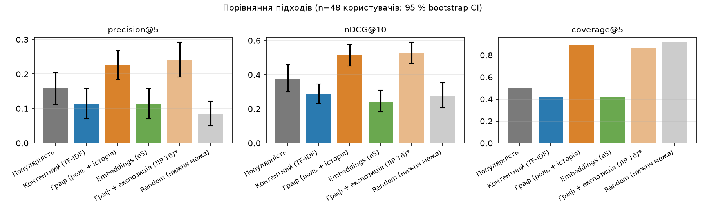
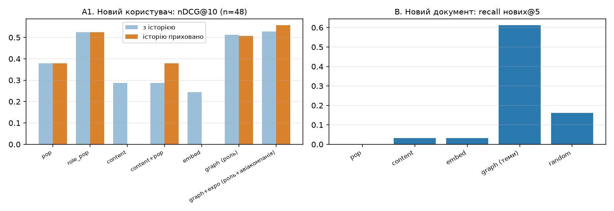

# СР 16. Оцінювання рекомендаційної системи — авіаційні перевезення

> ЧЕРНЕТКА, згенерована з results/\*.json. Перечитай, перевір числа й перепиши висновки своїми словами. Обсяг цілі — 2 сторінки.

## 1. Дані й протокол (C1)

Дані — синтетичні взаємодії з ЛР 16 (seed 42): 64 користувачі, 36 документів, 3309 подій. **Часове розбиття:** train — події до 2026-10-26 (2260), test — з 2026-10-26 до 2026-11-14 (1049). Випадкове розбиття некоректне: модель побачила б «майбутнє» й оцінка була б завищена.
Кандидати: документи, опубліковані до cutoff, доступні за рівнем доступу й ще не відкриті користувачем у train. Релевантні — open/save/helpful у test на кандидатах (view не рахується). Оцінено 48 користувачів з ≥ 1 релевантним документом (109 пар; відкинуто: {'already_seen_in_train': 203, 'not_published_yet': 24, 'access_denied': 9}).
Підходи: (1) **популярність** — зважена сума подій train; (2) **контентний** — TF-IDF за текстом документів, профіль = зважена сума векторів історії; (3) **граф** — вага теми з ролі користувача та його історії, оцінка документа = середня вага його тем (User→Role→Topic←Doc). Додатково: embeddings e5, нижня межа random, граф з експозицією з ЛР 16 (його зв'язки «рейс—ризик» датовані 2026-11-02/03, тобто **після** cutoff — це витік із майбутнього, тому в основну трійку не входить).

## 2. Результати (C2)

| Підхід                      | precision@5          | recall@5             | nDCG@10              | coverage@5 | novelty@5            | ILD@5                |
| --------------------------- | -------------------- | -------------------- | -------------------- | ---------- | -------------------- | -------------------- |
| **Популярність**            | 0.158 [0.113; 0.204] | 0.325 [0.226; 0.424] | 0.378 [0.300; 0.458] | 0.500      | 4.500 [4.379; 4.614] | 0.883 [0.867; 0.899] |
| **Контентний (TF-IDF)**     | 0.113 [0.071; 0.158] | 0.220 [0.137; 0.307] | 0.288 [0.232; 0.345] | 0.417      | 5.944 [5.860; 6.024] | 0.895 [0.878; 0.911] |
| **Граф (роль + історія)**   | 0.225 [0.183; 0.267] | 0.484 [0.387; 0.585] | 0.511 [0.451; 0.577] | 0.889      | 6.510 [6.322; 6.687] | 0.777 [0.749; 0.803] |
| Embeddings (e5)             | 0.113 [0.071; 0.158] | 0.189 [0.120; 0.267] | 0.244 [0.183; 0.308] | 0.417      | 5.965 [5.817; 6.096] | 0.871 [0.850; 0.892] |
| Граф + експозиція (ЛР 16)\* | 0.242 [0.192; 0.292] | 0.490 [0.392; 0.582] | 0.528 [0.467; 0.589] | 0.861      | 6.348 [6.189; 6.511] | 0.799 [0.775; 0.823] |
| Random (нижня межа)         | 0.083 [0.050; 0.121] | 0.208 [0.116; 0.311] | 0.274 [0.205; 0.352] | 0.917      | 6.133 [5.971; 6.301] | 0.850 [0.827; 0.874] |

95 % bootstrap-інтервали по користувачах (B=2000, seed=42); coverage — точкова оцінка по каталогу з 36 документів. \* варіант із фактами графа, датованими після cutoff (витік з майбутнього), див. README.

## 3. Холодний старт (C3)

**Новий користувач** (A1, історію 48 користувачів приховано від усіх моделей): контентний і embedding-підходи повертають порожній список у 100% випадків — без історії профіль не будується. Рішення — використати атрибути користувача: граф за роллю дає nDCG@10 0.507 проти 0.378 у популярності, популярність за роллю — 0.524.
Реальні нові користувачі (A2, n=8, 18 пар): інтервали настільки широкі, що підходи статистично не розрізняються — це обмеження вибірки, а не висновок.
**Новий документ** (B): recall нових@5 — популярність 0.00, контентний 0.03, граф 0.61 (із 31 пар): документ без взаємодій популярність не може показати за означенням, граф користується темами документа.

### A1. Новий користувач — симуляція (n=48, історію приховано)

| Підхід                         | precision@5          | nDCG@10              | coverage@5 | порожніх списків | nDCG@10 з історією | втрата nDCG |
| ------------------------------ | -------------------- | -------------------- | ---------- | ---------------- | ------------------ | ----------- |
| pop                            | 0.158 [0.113; 0.204] | 0.378 [0.300; 0.458] | 0.500      | 0%               | 0.378              | 0 %         |
| role_pop                       | 0.258 [0.204; 0.317] | 0.524 [0.433; 0.612] | 0.861      | 0%               | 0.524              | 0 %         |
| content                        | 0.000 [0.000; 0.000] | 0.000 [0.000; 0.000] | 0.000      | 100%             | 0.288              | 100 %       |
| content+pop                    | 0.158 [0.113; 0.204] | 0.378 [0.300; 0.458] | 0.500      | 0%               | 0.288              | -32 %       |
| embed                          | 0.000 [0.000; 0.000] | 0.000 [0.000; 0.000] | 0.000      | 100%             | 0.244              | 100 %       |
| graph (роль)                   | 0.238 [0.196; 0.279] | 0.507 [0.444; 0.577] | 0.833      | 0%               | 0.511              | 1 %         |
| graph+expo (роль+авіакомпанія) | 0.254 [0.208; 0.300] | 0.558 [0.491; 0.627] | 0.861      | 0%               | 0.528              | -6 %        |

Парна різниця з популярністю (A1): role_pop - pop [ndcg10]: +0.145 [+0.080; +0.211]; content - pop [ndcg10]: -0.378 [-0.458; -0.300]; content+pop - pop [ndcg10]: +0.000 [+0.000; +0.000]; embed - pop [ndcg10]: -0.378 [-0.458; -0.300]; graph (роль) - pop [ndcg10]: +0.129 [+0.028; +0.231]; graph+expo (роль+авіакомпанія) - pop [ndcg10]: +0.180 [+0.090; +0.273]

### A2. Реальні нові користувачі (з 8 у вибірці релевантні в test є у 8; пар: 18)

| Підхід                         | precision@5          | nDCG@10              |
| ------------------------------ | -------------------- | -------------------- |
| pop                            | 0.250 [0.125; 0.350] | 0.515 [0.314; 0.688] |
| role_pop                       | 0.275 [0.150; 0.375] | 0.600 [0.348; 0.814] |
| content                        | 0.000 [0.000; 0.000] | 0.000 [0.000; 0.000] |
| content+pop                    | 0.250 [0.125; 0.350] | 0.515 [0.314; 0.688] |
| embed                          | 0.000 [0.000; 0.000] | 0.000 [0.000; 0.000] |
| graph (роль)                   | 0.125 [0.050; 0.225] | 0.316 [0.174; 0.450] |
| graph+expo (роль+авіакомпанія) | 0.150 [0.050; 0.275] | 0.322 [0.146; 0.520] |

### B. Нові документи (en_air_traffic_flow_management, en_airport_slot, en_montreal_convention, en_overselling; n користувачів=56)

| Підхід       | recall нових@5 | пар релевантних нових | exposure@5 | precision@5 (усі) |
| ------------ | -------------- | --------------------- | ---------- | ----------------- |
| pop          | 0.000          | 31                    | 0.000      | 0.152             |
| content      | 0.032          | 31                    | 0.304      | 0.104             |
| embed        | 0.032          | 31                    | 0.161      | 0.108             |
| graph (теми) | 0.613          | 31                    | 0.821      | 0.252             |
| random       | 0.161          | 31                    | 0.464      | 0.088             |

## 4. Етичні ризики й заходи (C4)

| Ризик                                       | Доказ у даних                                                                                                                                                   | Захід                                                                                                                         |
| ------------------------------------------- | --------------------------------------------------------------------------------------------------------------------------------------------------------------- | ----------------------------------------------------------------------------------------------------------------------------- |
| Упередженість до популярного (довгий хвіст) | Популярність: Gini експозиції 0.72, 58% рекомендацій із 20 % найпопулярніших (частка релевантних пар там 22%), 18 з 36 документів не рекомендовано жодного разу | Персоналізація/граф (Gini 0.47), резерв позицій для нових і «довгохвостих» документів; моніторинг coverage                    |
| «Бульбашка» тем                             | Граф: ILD@5 0.78 (найнижча), лише 16% рекомендацій із новою для користувача темою                                                                               | MMR-переранжування λ=0.7: ILD@5 0.83 (+0.049), nDCG@10 -0.013 [-0.043; +0.015]                                                |
| Приватність і доступ                        | Без фільтра 35% користувачів графа отримали б документ вище свого рівня доступу; пара role+airline+home_airport унікальна для 94% користувачів                  | Фільтр за рівнем доступу до ранжування (порушень 0); мінімізація атрибутів, pseudonym id, k-анонімність при публікації метрик |
| Нерівність якості між групами               | nDCG@10 за ролями: розрив max−min 0.20 (граф), 0.30 (популярність); у ролі лише ~10 користувачів                                                                | Моніторинг метрик за групами; перегляд ваг ролей; пояснення рекомендацій                                                      |

## 5. Висновки

- Найкращий з трійки за точністю — граф: precision@5 0.225, nDCG@10 0.511 проти 0.378 у популярності (різниця nDCG +0.133, значущо); coverage 0.89 проти 0.50, novelty 6.51 проти 4.50.
- Контентний підхід (TF-IDF) не кращий за популярність (nDCG 0.288; різниця -0.091, значущо): у цих даних інтерес визначають роль і тема, а не лексична схожість текстів.
- Результат залежить від протоколу: якщо дозволити повторні рекомендації вже бачених документів, порядок змінюється — nDCG@10 популярність 0.583, контентний 0.587, граф 0.534 (results/main_table_include_seen.md). Тому вилучення «seen» зафіксовано в протоколі явно.
- Обмеження: дані синтетичні й згенеровані з тих самих сигналів, що й граф (ролі, теми), тож абсолютні числа оптимістичні для графа; 36 документів; малі вибірки у холодному старті.

## 6. Декларація використання генеративного ШІ

- Модель: Claude (Anthropic) — Sonnet 5.5.
- Призначення: допомога з каркасом коду (метрики, протокол оцінки, холодний старт), чернетка звіту, пошук гіпотез щодо розбіжностей між підходами.
- Приклад запиту: "Створи програмне середовище для виконання роботи".
- Як перевірено: метрики перераховано вручну на прикладі (tests/test_metrics_and_protocol.py, 7 тестів), перевірено відсутність витоку (train < cutoff ≤ test; кандидати без майбутніх документів), числа в звіті взяті з results/\*.json; <допиши, що перевірив сам>.

## 7. Самоперевірка

1. **Чому випадкове розбиття некоректне?** Воно змішує час: модель вчиться на подіях «після» тих, які оцінює, а реальна система завжди передбачає майбутнє за минулим.
2. **Що таке coverage?** Частка каталогу, яка потрапила хоча б одному користувачу в top-k (0.89 у графа, 0.50 у популярності).
3. **Як розв'язано холодний старт?** Новий користувач — атрибути (роль) через граф або популярність за роллю; новий документ — теми/текст замість взаємодій.
4. **Ризики «бульбашок» і як зменшити?** Звуження тем (ILD@5 0.78 у графа); зменшують MMR-різноманітність, резерв позицій для нових тем, моніторинг ILD і частки нових тем.
